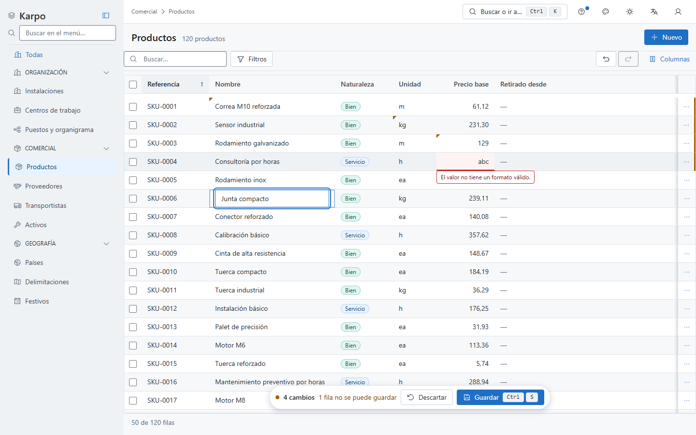
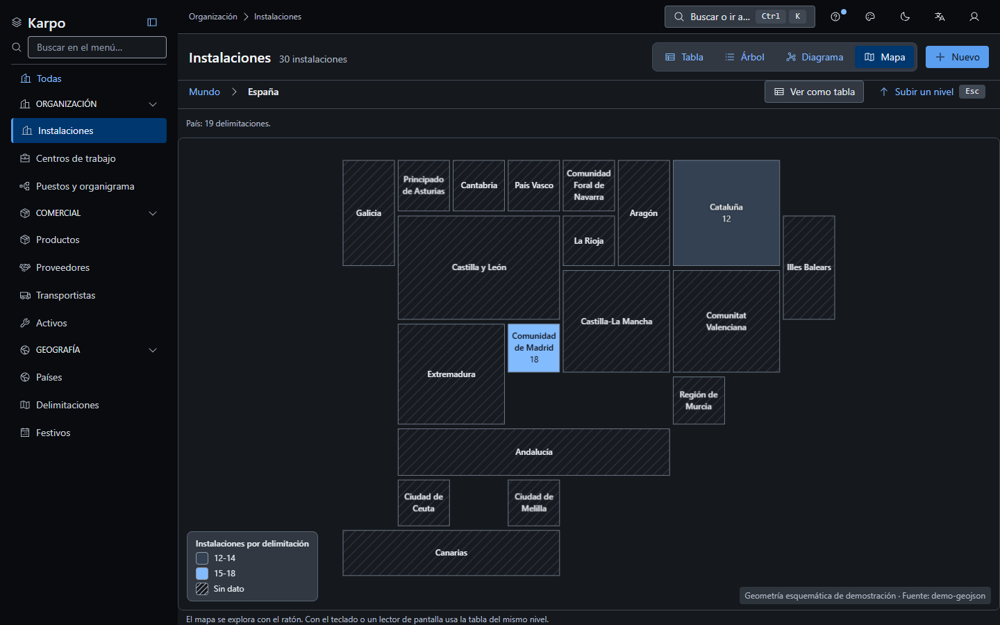

# @karpo/react

Front React de **Karpo Go** (ERP/CRM): una aplicación dirigida por configuración, con cuadrículas
editables, organigramas y mapas por niveles. Equivale al runtime Angular de Karpo C#
(`front/angular`) y lee **la misma configuración JSON por entidad**; no hay código escrito a mano por
pantalla.

- **Cuadrículas**: edición en línea con validación, deshacer y rehacer, guardado optimista o por lotes
  (siempre con `version`), conflictos 409 con «recargar y reaplicar» y teclado completo. El doble clic
  en una fila abre el **detalle en modo edición**.
- **Vistas alternativas** con un único control de vista en la cabecera de cada entidad (Tabla · Árbol ·
  Diagrama · Mapa, según lo que declare su configuración): organigrama como árbol navegable con zoom y
  plegado, también legible en el móvil; datos geográficos en un mapa por niveles (mundo, país, región, ciudad).
- **Soberanía**: ninguna tesela ni fuente de terceros en tiempo de ejecución. Los mapas usan geodatos
  del propio despliegue (GeoJSON o PMTiles con MapLibre) y el origen es configurable.
- **Temas** de Theros Front (variables `--th-*`, sin valores fijos), claro y oscuro, **RTL**, idiomas `es`
  y `en` con estructura lista para más.
- **Ayuda guiada** en todas las pantallas (driver.js): un botón lanza un recorrido por los elementos
  de la pantalla, con textos de la configuración, traducidos.
- Se publica como paquete npm (`@karpo/react`, versión `0.1.0`). **No se publica todavía**:
  `"private": true` en `package.json` y `prepublishOnly` lo impiden a propósito.

Plan y decisiones: [`docs/PLAN.md`](docs/PLAN.md). Peticiones a otros equipos:
[`docs/PETICIONES-BACKEND.md`](docs/PETICIONES-BACKEND.md) y
[`docs/PETICIONES-THEROS-FRONT.md`](docs/PETICIONES-THEROS-FRONT.md).



## Requisitos

| Qué | Para qué |
|---|---|
| **Node 24.15 o posterior para desarrollar** (`devEngines.runtime` pide `>=24.15` con `onFail: "warn"`) | Todo lo de esta carpeta |
| **Microsoft Edge o Google Chrome** instalados | Pruebas e2e y capturas (`playwright-core` usa el navegador del sistema; **no descarga nada**) |
| **Go** y el repositorio completo | Sólo el modo local contra `cmd/karpo` (`npm run karpo:local`) |

**Por qué Node 24.15.** El paquete publicado es de navegador y **no declara `engines`** (quien lo instala puede
tener cualquier Node). Lo que pide 24.15 son las herramientas de desarrollo (`jsdom`, `stylelint`…), y por eso
la carpeta lo declara en `devEngines`. Con Node 24.14, `npm ci` y cada orden de `npm run` imprimen un aviso
`EBADDEVENGINES` («Invalid devEngines.runtime… does not match v24.14.1»): es sólo un aviso (`onFail: "warn"`),
todo funciona, pero conviene actualizar.

Sólo se usan paquetes del registro público de npm; todas las dependencias directas son MIT, Apache-2.0
o BSD (ver [Licencias](#licencias)).

## Instalación

```
cd front/react
npm ci
```

`npm ci` instala exactamente lo de `package-lock.json` (`.npmrc` fija `ignore-scripts=true` y
`save-exact=true`). Sin Edge ni Chrome, `npm run test:e2e` salta las pruebas con un aviso.

## Modo demo (sin servidor)

```
npm run dev
```

Arranca Vite en el modo `demo` (http://127.0.0.1:5173, o el siguiente puerto libre). Un backend falso
(MSW, en el navegador) responde con datos deterministas: 3 organizaciones, 30 instalaciones, 120
productos, 45 puestos en 5 niveles, 248 países y las delimitaciones de España. El usuario de la demo y
su contraseña están en [`demo/data/credenciales-demo.json`](demo/data/credenciales-demo.json) (valores de
prueba de la propia demo): `demo` es administrador, `lectura` sólo lee y `nuevo` debe cambiar la contraseña.

Cosas que conviene saber:

- El estado y las sesiones del backend falso viven en la memoria de la página: **recargar la página cierra
  la sesión y restaura los datos**. Navega dentro de la aplicación.
- `?fallo=409` (también `403`, `404`, `413`, `422`, `500`, `503`) en la URL de la página fuerza ese error
  en las escrituras; `?fallo=202` o `?aprobacion=1`, una aprobación pendiente. Sirve para ver el conflicto.
- `?lng=en` cambia el idioma y `?dir=rtl` fuerza la dirección (sin necesidad de un idioma RTL real).
- Para servir una compilación: `npm run build:demo` (emite también `demo/config` en `demo/dist/config`) y
  `npm run preview`. Las pruebas e2e y las capturas compilan la demo en producción antes de servirla.

## Modo local contra Karpo Go

```
npm run karpo:local
```

Karpo Go de verdad, sin datos falsos. El script (`scripts/karpo-local.mjs`):

1. compila `cmd/karpo` (raíz del repositorio, sólo lectura) a una carpeta temporal, **sin red**
   (`GOPROXY=off`);
2. crea un **SQLite temporal**, un secreto JWT y una contraseña de arranque aleatorios (nunca una base
   viva ni el puerto 55432);
3. busca **puertos libres** (Go desde el 18741 y Vite desde el 5173; prueba un `listen` real, así se
   evitan los rangos reservados de Windows), ejecuta `migrate` y `serve` y espera a `/readyz`;
4. **siembra** por HTTP los mismos datos que la demo (`scripts/seed-karpo.mjs`) y escribe un informe;
5. arranca Vite con un proxy de `/api`, `/healthz` y `/readyz` hacia Go (Go no tiene CORS).

Al final imprime `front en http://127.0.0.1:5173 · API de Go en http://127.0.0.1:18741`. **Ctrl+C** lo para
todo y borra la carpeta temporal. Si algo quedara vivo, `npm run karpo:stop` mata los procesos registrados
(`karpo` y `vite`) comprobando antes que el pid sigue siendo el mismo programa.

Dónde queda cada cosa (carpeta `.karpo-local/`, ignorada por git):

| Fichero | Contenido |
|---|---|
| `credenciales.json` | Usuario y contraseña de la ejecución (valores de prueba de una base temporal) |
| `siembra.json` | Informe del sembrador, con los fallos que toleró |
| `karpo.log` | Salida de Go |
| `pids.json` | Procesos vivos, para `karpo:stop` |

Opciones: `npm run karpo:local -- --smoke` comprueba el login y `GET /api/v1/facilities` (directo y por el
proxy) y termina; `--keep` conserva la carpeta temporal; `--no-vite` no arranca Vite.

## Configuración

La aplicación se maneja por configuración. `KarpoApp` carga un **manifiesto** y de él salen entidades,
menú, idiomas, tema y mapas:

```tsx
import { KarpoApp } from '@karpo/react';
import '@karpo/react/karpo.css';
import '@karpo/react/map.css'; // sólo si alguna entidad tiene vista de mapa

createRoot(root).render(
  <KarpoApp manifestUrl="/config/manifest.json" themeOrigin="/themes/" apiBaseUrl="/api" router="browser" />,
);
```

- **`@karpo/react/map.css`**: la hoja de MapLibre (`.maplibregl-*`, unos 70 kB sin comprimir) va **aparte** de
  `karpo.css` (D-R24). Quien use mapas la importa; quien no, no paga sus bytes. Lleva además
  `font: inherit` sobre `.maplibregl-map`, para que los controles y rótulos del mapa usen la tipografía del tema y
  no la de MapLibre. La demo la carga junto con la vista del mapa.

- **`manifest.json`** (propuesta de formato para el pack karpo-go de Theros, `docs/PLAN.md` §4.3.1;
  ejemplo vivo en [`demo/config/manifest.json`](demo/config/manifest.json)). Registra cada entidad con su
  `path` (los `*.config.json` de `front/angular/config/entities`, **sin copiarlos ni modificarlos**), sus
  permisos y su **superposición**.
- **Superposición (`overlay`)**: tiene la forma del JSON de Angular y se fusiona en profundidad antes de
  normalizar. Sirve para lo que el JSON de Angular no sabe decir: vistas de árbol y mapa (`views`), claves
  ajenas (`lookup…`), ayuda (`help.steps`), `serverSortFields`, `saveMode` (`optimistic` o `batch`) y
  `presentation` (`panel` o `page`).
- **Compatibilidad**: [`docs/COMPATIBILIDAD-CONFIG.md`](docs/COMPATIBILIDAD-CONFIG.md) dice clave a clave
  qué se soporta, qué se normaliza y qué se ignora (con aviso). Un tipo desconocido se degrada a `text`
  **con aviso**.
- **Textos**: cada literal admite su clave (`name` + `nameKey`) o un objeto por idioma; se resuelve en este
  orden: clave traducida, diccionario del manifiesto (`i18n`), objeto por idioma, literal. El código nunca
  lee el literal directamente (lo impide eslint, ver [Reglas del código](#reglas-del-código)): todo pasa por
  `useText()`/`resolveText()`. La convención de claves de la demo (D-R28) está en
  [`docs/COMPATIBILIDAD-CONFIG.md`](docs/COMPATIBILIDAD-CONFIG.md).
- **Idiomas con escritura de derecha a izquierda**: con `dir=rtl` cada valor interpolado en una cadena
  de i18next se envuelve en aislantes Unicode (FSI y PDI) para que un número o un nombre no reordene la frase.
  Una instancia de i18next creada fuera de `createI18n` (pasada a `I18nProvider`) no los pone.
- **Página anfitriona**: `KarpoApp` ocupa toda la ventana; quien la aloja pone `body { margin: 0 }` (la demo lo hace en
  `demo/index.html`).
- **Origen de los temas**: `themeOrigin` (o `manifest.theme.origin`): la carpeta donde están
  `<tema>/index.css` y `<tema>/manifest.json`. En la demo, `/themes/` (`demo/public/themes/`).
- **Origen de los mapas**: `manifest.map.sources`. Un `geojson` usa una URL con `{level}` (`world`,
  `country-ES`, `region-ES30`, `city-ES300`); un `pmtiles` usa la URL de un `.pmtiles` y la `layer`.
  Pueden apuntar a otro origen del propio despliegue (hay que permitir `connect-src` y `Range`). El mapa
  nunca pide nada a un servicio de teselas de terceros. Con Vite, el worker de MapLibre sale del propio
  despliegue sin más; con otro empaquetador, sirve `maplibre-gl-worker.mjs` y llama a
  `setMapWorkerUrl('/ruta/maplibre-gl-worker.mjs')` antes de abrir el primer mapa.
- **API**: `manifest.api.baseUrl` y `apiBaseUrl`. El adaptador sigue el contrato de mantenimiento de Go
  (`version` siempre en los cambios, 409 como conflicto, problem+json en sus dos formas, refresco único
  del JWT y `X-Organization-Scope`).

## Temas

Los temas los genera **Theros Front**; esta carpeta los consume sin valores fijos (todo color, tipografía,
espaciado y radio sale de `--th-*`; `stylelint` impide los literales). Lo que el contrato no cubre vive en
una capa propia, `karpo.ext` (`--kx-*`), y se anota en
[`docs/PETICIONES-THEROS-FRONT.md`](docs/PETICIONES-THEROS-FRONT.md).

```
npm run themes:sync
```

Ejecuta el generador de Theros Front en modo sólo lectura (`go run ./cmd/theros-front build <tema>` con la
salida en una carpeta temporal; carpeta por defecto `C:\Git\Paranoia\Theros.Front`, o `THEROS_FRONT_DIR`),
copia los CSS y el manifiesto de `modern-flat`, `classic-1995`, `glossy-2003` y `souq` a
`demo/public/themes/<tema>/` y escribe `THEMES.md` con el commit, el hash del diccionario y la fecha. Lo
generado se versiona: la demo no necesita Theros Front instalado. `THEROS_THEMES` elige los temas.



## Geodatos

La demo usa **geometría esquemática generada** (un cartograma; se rotula como «Geometría esquemática de
demostración»), sin ficheros de terceros ni números aleatorios.

```
npm run geo:build      # demo/public/geo/*.geojson (24 ficheros), determinista; --check falla si hay desfase
npm run tiles:build    # demo/public/geo/karpo-demo.pmtiles (PMTiles v3, MVT); --check falla si no coincide
```

Para un despliegue real hace falta un `.pmtiles` con geometrías verdaderas (hecho con una herramienta
externa, p. ej. tippecanoe) con las mismas propiedades (`code`, `name`, `level`, `parentCode`, `nutsCode`,
`lauCode`…) y cada nivel de detalle ya presente en los zooms bajos; se configura en `manifest.map.sources`.
Ver la petición B-2 del backend.

## Iconos y textos de la demo (generados)

Dos ficheros son **generados** y se versionan; `npm run check` comprueba que están al día.

```
npm run icons:gen      # src/ui/icon-data-core.ts e icon-data-extra.ts desde los defs de Phosphor (pesos regular y fill)
npm run i18n:demo      # demo/config/overlays/*.i18n.json y demo/config/i18n/{es,en}.json
```

- **`icons:gen`** (`scripts/gen-icons.mjs`) dibuja una vez, con `react-dom/server`, cada nombre de
  `ICON_NAMES` (`src/contracts/icons.ts`: nombres kebab de Phosphor más unos alias de compatibilidad) y escribe
  los trazados en **dos módulos** (D-R37): `src/ui/icon-data-core.ts` (los de `CORE_ICON_NAMES`, los que pinta
  el propio marco: dentro del trozo inicial, lectura síncrona) y `src/ui/icon-data-extra.ts` (el resto: se pide
  con `import()` al arrancar y no cuenta para el presupuesto; mientras llega, `<Icon>` pinta un `svg` vacío del
  mismo tamaño, `data-kx-icon="pending"`, y se repinta al llegar). En ejecución no se importa Phosphor
  (`@phosphor-icons/react` es sólo `devDependency`; su aviso de copyright va en `dist/THIRD-PARTY-NOTICES.md`).
  Para un icono nuevo: añadir el nombre a `ICON_NAMES` (y a `CORE_ICON_NAMES` si lo pinta una pantalla del marco;
  lo vigila `src/ui/icons-core.contract.test.ts`), ejecutar `npm run icons:gen` y llevar los dos ficheros
  resultantes; sin ellos, `tsc` rompe. Un nombre desconocido pinta un círculo con `data-kx-icon="missing"`, avisa
  una vez en desarrollo y la normalización de la configuración lo anota como `ConfigWarning` con su ruta
  (`menu[3].children[1].icon`). `-- --check` falla si algún fichero no está al día. `ICON_DATA` (público) trae
  ahora sólo el núcleo: para leer cualquier nombre, `iconData(name)`.
- **`i18n:demo`** (`scripts/gen-demo-i18n.mjs`) saca los ~270 literales españoles de las 8 configuraciones de Go,
  les pone clave (`entities.<id>.columns.<campo>.header`…, D-R28) en superposiciones y escribe el diccionario
  español (los literales) y el inglés (de la tabla revisada a mano `demo/config/i18n/en.go.json`). `-- --check`
  falla si falta una clave en inglés, si sobra alguna o si lo generado no está al día. Es la prueba de concepto
  de TC-3 (ver `docs/PETICIONES-THEROS-FRONT.md`); `e2e/ingles.e2e.ts` comprueba que con `lng=en` no se ve ni un
  literal español de Go.

## Límites conocidos

- **Columnas no virtualizadas.** La cuadrícula virtualiza **filas** (`@tanstack/react-virtual`), no columnas:
  están pensadas para entidades de **hasta unas 40 columnas visibles**. Con muchas más, el pintado de cada fila
  crece de forma lineal. Las configuraciones de Go tienen entre 3 y 6.
- **Marco compacto.** Por debajo de 40 em de ancho de marco (el tema usa 14 px de base: unos 560 px) la barra
  superior pasa al modo compacto (menú «Más») y por debajo de 64 em el detalle es página completa.
- **Geometría de demostración.** Es esquemática y está rotulada como tal; el origen es configurable para un
  `.pmtiles` real (consulta Q-4 y petición B-2).

## Presupuesto de bytes

```
npm run build && npm run presupuesto
```

`scripts/presupuesto.mjs` suma el tamaño **gzip** del trozo inicial de la demo (el módulo de entrada de
`demo/dist`, sus importaciones estáticas y sus hojas, según `demo/dist/.vite/manifest.json`) y falla si pasa de
**215 kB**. El límite, el objetivo y su obligatoriedad están en [`scripts/presupuesto.json`](scripts/presupuesto.json)
(`{ "limitKb": 215, "targetKb": 200, "enforce": true }`, D-R29 y D-R37): `limitKb` es el techo obligatorio y
`targetKb` el objetivo informativo; si la medida baja de 197 kB, el límite se baja a 200. `npm run check` lo
ejecuta después de `build`. Antes (ronda 2) el límite era de 250 kB y el trozo inicial rozaba los 243 kB.

Qué queda **fuera** del trozo inicial, con carga diferida: el detalle, la paleta de órdenes, los paneles
redimensionables, `driver.js`, MapLibre, PMTiles, el organigrama, la cuadrícula y la hoja del mapa; los iconos
que no son del marco (`icon-data-extra`); las pantallas de acceso y de cambio de contraseña (`lazy()`); y los
textos: sólo se cargan el idioma activo y los espacios del marco (`core`, `ui`, `fields`, `auth`, `errors`,
`help`), y `grid`, `detail`, `tree` y `map` llegan con su vista (`ensureNamespaces` en `shell/lazy.ts` y
`shell/views.tsx`). El normalizador de la configuración (con su tabla de compatibilidad y el esquema de `zod`) se
descarga a la vez que el manifiesto, fuera del trozo de entrada. También informa del tamaño de
`dist/karpo-react.js`, que no tiene límite propio. Medir siempre sobre una compilación de producción
(`NODE_ENV` distinto de `production` mete React en desarrollo y duplica los bytes).

```
npm run presupuesto -- --detalle   # atribución por paquete (con los mapas de fuentes de demo/dist)
```

`--detalle` imprime cuánto pesa cada paquete o carpeta en el trozo inicial y comprueba que no entran en él
`icon-data-extra`, las pantallas de acceso ni los textos de las vistas (con `enforce`, si entran, falla).

**Idioma árabe de demostración.** Desde la ronda 3 la demo trae el árabe (`ar`) como idioma de derecha a izquierda
real (D-R38). Es una traducción **de demostración, sin revisión nativa** (consulta Q-5, abierta): sirve para
probar el espejo, los aislamientos bidireccionales y las capturas `rtl`, no para producción. Las cifras salen
siempre en dígitos latinos en todos los idiomas (`numberingSystem: 'latn'`). `?dir=rtl` con otro idioma sigue
funcionando.

## Reglas del código

Se comprueban con `npm run lint` y tienen su prueba en `build/lint-config.test.ts`:

- **Sin valores fijos de tema** (stylelint): ni colores, ni tipografías, ni longitudes literales; `style` en línea
  sólo admite variables `--kx-*` y propiedades de disposición (eslint).
- **Sin `:dir()` en el CSS** (stylelint, D-R22): `lightningcss`, que Vite usa para minificar, lo compila a
  `:lang(ar,he,…)`, que depende del idioma y no sigue a `?dir=rtl` ni a `<html dir>`. Se usa `[dir="rtl"]`.
  `build/css-dir.test.ts` compila `src/**/*.css` con la transformación de CSS y los `targets` de Vite y falla si
  la salida contiene `:lang(ar`.
- **Sin `.literal` fuera de `src/config` y `src/fields/values.ts`** (eslint): los textos de la configuración se
  resuelven con `useText()` o `resolveText()` (clave, idioma y diccionario antes que el literal).

## Pruebas

```
npm run check
```

Es la batería completa: `typecheck`, `lint` (eslint y stylelint), `test` (unitarias y de componentes con
jsdom, Testing Library y MSW), `test:contract` (ganchos de Theros, claves de i18n iguales en es/en, contraste
de los temas), `licencias --check`, `icons:gen --check`, `i18n:demo --check`, `build` (`build:lib` y
`build:demo`), `presupuesto` y `pack:check`. `npm run coverage` mide la cobertura (exigida ≥ 80 % en
`config`, `api`, `fields` y el almacén de edición).

```
npm run test:e2e
```

Pruebas de extremo a extremo con **vitest + playwright-core** y el Edge (o Chrome) instalado, contra la
demo compilada **en producción** y servida con `vite preview` en un puerto libre. Cubren: doble clic → detalle
en edición; edición en línea con validación, deshacer y guardado por lotes; 409; teclado de la cuadrícula
(`Tab` sale de la rejilla y sólo al editar confirma y avanza); detalle (`version`, errores de campo, conflicto,
alta); organigrama (listado ⇄ diagrama, plegado, zoom, teclado); mapa en cuatro niveles con clics reales,
migas y Esc, tipografía del tema y leyenda que no tapa la geometría; ayuda guiada; temas (claro, oscuro,
`classic-1995`, `glossy-2003`, con alturas desde variables y contraste AA); RTL (espejo de los iconos, ningún
`:dir()` y aislantes bidi); el menú (`menu.e2e.ts`: ningún icono desconocido); el móvil (`movil.e2e.ts`: 360 y
390 px con pantalla táctil, sin desbordes ni teclas); y el idioma: **ninguna clave de i18n sin traducir**
(`i18n.e2e.ts`) y **ningún literal español de las 8 configuraciones de Go con `lng=en`** (`ingles.e2e.ts`).
**Todas** comprueban que ninguna petición sale del origen de la demo. Con `KARPO_LOCAL=1` también se ejecuta
`e2e/local.e2e.ts` contra `npm run karpo:local` (login real, lista, cambio con `version` y árbol de puestos
con el control de vista de la cabecera). Dos suites no se pueden ejecutar a la vez en la misma carpeta:
`vite preview` (Vite 8) toma un bloqueo por proyecto.

## Capturas

```
npm run capturas
```

Compila la demo (en producción), la sirve, abre el navegador y guarda **41 imágenes** en
[`docs/capturas/`](docs/capturas/README.md) con una tabla de ficheros, la fecha, el navegador y su versión: las
9 escenas en claro, oscuro, RTL e inglés (LTR), y 5 escenas en un teléfono (390×844 con pantalla táctil:
cuadrícula, detalle, organigrama en listado, mapa del mundo y ayuda). Prepara cada escena con interacciones
reales (doble clic, teclado) y falla si falta alguna imagen o si alguna petición salió del origen. Ventana
1440×900 (390×844 en móvil), escala 1, movimiento reducido.

Sólo se versionan tres: [cuadrícula editable en claro](docs/capturas/cuadricula-editable-claro.png), [mapa de país en oscuro](docs/capturas/mapa-pais-oscuro.png) y [organigrama en diagrama en RTL](docs/capturas/organigrama-diagrama-rtl.png). Las otras 38 quedan fuera de git (`.gitignore`) y aparecen en la carpeta al ejecutar `npm run capturas`.

## Licencias

El paquete es `GPL-2.0-only` (la del repositorio; consulta Q-3). Las dependencias **directas** son sólo
MIT, Apache-2.0 o BSD; las transitivas con otras licencias permisivas (ISC, 0BSD, CC0, BlueOak, CC-BY para
`caniuse-lite`…) se listan en [`docs/LICENCIAS.md`](docs/LICENCIAS.md), que genera el script y que nunca
admite GPL, AGPL, LGPL, SSPL, EUPL, EPL ni licencias comerciales. Prohibidos como directas: AG Grid
Enterprise, Handsontable, Shepherd.js, `axe-core` (MPL-2.0) y los `d3-*` (ISC).

```
npm run licencias            # regenera docs/LICENCIAS.md desde package-lock.json
npm run licencias -- --check # falla si hay una licencia no permitida, el informe está desfasado o un origen incrustado no está en el lock
npm run licencias -- --avisos # regenera dist/THIRD-PARTY-NOTICES.md (lo hace también npm run build:lib)
```

**Avisos de terceros (B-1).** Tres proyectos no llegan como dependencia de quien instala el paquete, sino
**copiados dentro de `dist/`**, y su licencia exige conservar su aviso: los trazados de iconos de **Phosphor Icons**
(MIT), la hoja de estilos de **MapLibre GL JS** (BSD-3-Clause) y la hoja base de **React Flow / xyflow** (MIT).
Sus avisos y el texto íntegro de sus licencias van en
[`dist/THIRD-PARTY-NOTICES.md`](dist/THIRD-PARTY-NOTICES.md) (se genera al construir la biblioteca, desde el
`LICENSE` de `node_modules`, con el registro de [`scripts/avisos.mjs`](scripts/avisos.mjs); no se versiona),
`dist/karpo.css` y `dist/karpo-map.css` empiezan por un comentario `/*!` que lo cita, y `npm run pack:check` falla
si falta el fichero, si le falta un origen o su licencia, o si entra algo incrustado que no consta en el registro
(un `@import` de un paquete en un CSS de `src/` o una fuente `node_modules/` en un mapa de `dist/`). El diagrama
oculta la atribución de `@xyflow/react` (MIT lo permite): consulta Q-11 en
[`docs/CONSULTAS-JAVIER.md`](docs/CONSULTAS-JAVIER.md).

No se copia código del framework Go.

## Empaquetado

```
npm run build:lib    # vite build (dist/karpo-react.js, dist/karpo.css y dist/karpo-map.css) y los tipos (dist/types)
npm run pack:check   # npm pack --dry-run y comprobación del contenido
```

El paquete expone `.` (el JavaScript y los tipos), `./karpo.css` y `./map.css` (la hoja de MapLibre, aparte).
Es sólo `dist/` (con `dist/THIRD-PARTY-NOTICES.md`, ver [Licencias](#licencias)), `package.json`, `README.md` y `LICENSE`; `react` y `react-dom` son dependencias
`peer` (`>=19.2.7`) y todo lo demás sale como dependencia externa. La versión es `0.1.0`. **No se publica**:
`npm publish` falla a propósito (`"private": true` y `scripts/no-publish.mjs`) hasta que Javier decida otra cosa; para publicar hay que quitar las dos cosas.

## Consultas abiertas

Decisiones por defecto que se aplican mientras Javier no diga otra cosa (`docs/PLAN.md` §2). **El estado de cada
una, qué pasa si no se responde y lo que costaría cambiarla después están en
[`docs/CONSULTAS-JAVIER.md`](docs/CONSULTAS-JAVIER.md)**, pensado para responderlas en un minuto.

| # | Pregunta | Por defecto |
|---|---|---|
| Q-1 | ¿Se acepta `style` con variables de disposición (D-R12)? | Sí, sólo disposición (`--kx-*`, transformaciones), vía CSSOM |
| Q-2 | ¿Se incluye en el paquete una copia generada de `modern-flat` como tema por defecto? (licencia de lo generado por Theros Front sin declarar) | No: la demo lo sirve desde `demo/public/themes/` y el paquete pide `themeOrigin` |
| Q-3 | Licencia del paquete `@karpo/react` | `GPL-2.0-only`, la del repositorio; cambiarla es una línea |
| Q-4 | Geometrías reales: ¿de dónde? | Demo con geometría esquemática generada y origen configurable para un `.pmtiles` real (petición B-2) |
| Q-5 | ¿Se encarga una revisión nativa del árabe de la demo? | Árabe de demostración **sin revisión nativa** (D-R38); la estructura admite más idiomas y `?dir=rtl` sigue disponible |
| Q-6 | `lightningcss` (MPL-2.0) como transitiva de desarrollo de Vite (otras transitivas ISC/BlueOak/CC0 se listan en el informe) | Se usa **por defecto mientras Javier no decida**; no se distribuye. Alternativa: `cssMinify: 'esbuild'`. Ojo: sus `targets` cambian el CSS publicado (compila `:dir()` a `:lang()`; D-R22) |
| Q-8 | Geometría real para la demo (M-5): Natural Earth (dominio público) convertida a un PMTiles propio. Hace falta que Javier aporte el fichero o autorice la descarga; `world-atlas` (ISC) por npm, sólo con su visto bueno | Geometría esquemática rotulada (Q-4) y origen configurable |
| Q-9 | `polylabel` (ISC) para colocar los rótulos del mapa | No: cálculo propio del polo de inaccesibilidad (`src/map/polylabel.ts`) |
| Q-10 | Un nivel del mapa con una sola delimitación: ¿saltarlo o conservarlo? | Saltarlo (`map.skipSingle: true` por omisión, configurable por entidad) |
| Q-7 | Paleta de datos provisional mientras no llegue PT-5 | Provisional en `karpo.ext` |
| Q-11 | Atribución de `@xyflow/react` en el diagrama (MIT permite ocultarla; el fabricante la pide por cortesía) | Oculta, con su aviso en `dist/THIRD-PARTY-NOTICES.md`; alternativas: visible y configurable, o suscripción |
| Q-12 | ¿Las cantidades de dinero (`money`) en monoespaciada? | No: `tabular-nums` en la familia del cuerpo para todas las cifras (D-R35) |

Las consultas Q-8 a Q-10 son de la ronda 2 y Q-11 y Q-12 de la ronda 3. Ocultar la atribución de `@xyflow/react` es una
línea en `src/tree/TreeDiagram.tsx` (`proOptions.hideAttribution`) si se prefiere mostrarla.

## Documentación

- [`docs/PLAN.md`](docs/PLAN.md): plan, decisiones y arquitectura.
- [`docs/CONSULTAS-JAVIER.md`](docs/CONSULTAS-JAVIER.md): las consultas abiertas (Q-1 a Q-12), con recomendación, qué pasa si no se responden y coste de cambiar.
- [`docs/PLAN-RONDA-3.md`](docs/PLAN-RONDA-3.md): decisiones D-R31 a D-R40 de la ronda 3.
- [`docs/COMPATIBILIDAD-CONFIG.md`](docs/COMPATIBILIDAD-CONFIG.md): qué hace el motor con cada clave del JSON de Angular.
- [`docs/PETICIONES-BACKEND.md`](docs/PETICIONES-BACKEND.md) y [`docs/PETICIONES-THEROS-FRONT.md`](docs/PETICIONES-THEROS-FRONT.md).
- [`docs/LICENCIAS.md`](docs/LICENCIAS.md), [`docs/capturas/`](docs/capturas/README.md) y [`docs/analisis/`](docs/analisis/).
- [`docs/PLAN-RONDA-2.md`](docs/PLAN-RONDA-2.md) y [`docs/jurado/ronda-1.md`](docs/jurado/ronda-1.md): lo que pidió el jurado y cómo se resolvió.
  **El jurado de [`docs/jurado/`](docs/jurado/) es histórico:** las rondas 1 a 3 (aprobado en la
  3, con 8,6) se hicieron con el bucle de cuatro agentes con el que se construyó el front. Las
  tareas nuevas siguen la forma de trabajo del repositorio
  ([`docs/FORMA-DE-TRABAJO.md`](../../docs/FORMA-DE-TRABAJO.md)), con un juez por rol (juez-ux en
  el front), y dejan su memoria en `docs/trabajo/<tarea>/` (en la raíz del repositorio).
- [`docs/notas/`](docs/notas/): notas de cada tarea (T1 a T8 y R1 a R4 de la ronda 2), con lo comprobado y lo pendiente; [`INTEGRACION.md`](docs/notas/INTEGRACION.md) recoge el cierre de cada ronda.
